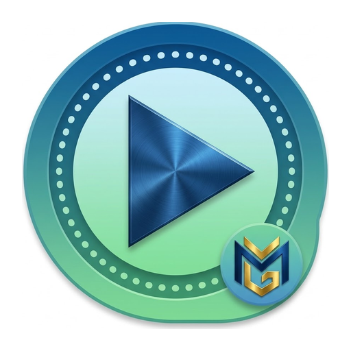
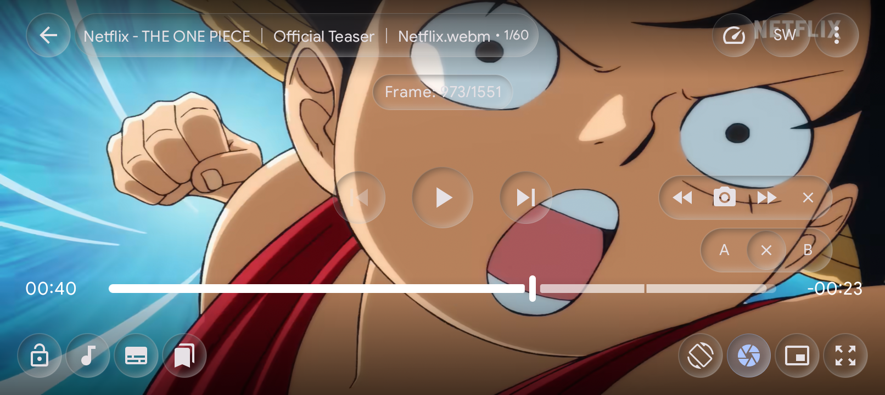
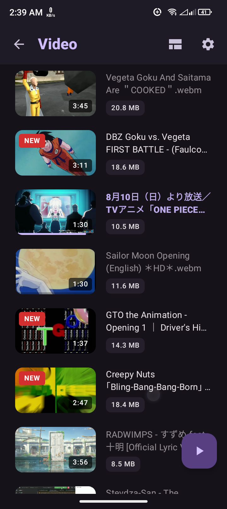
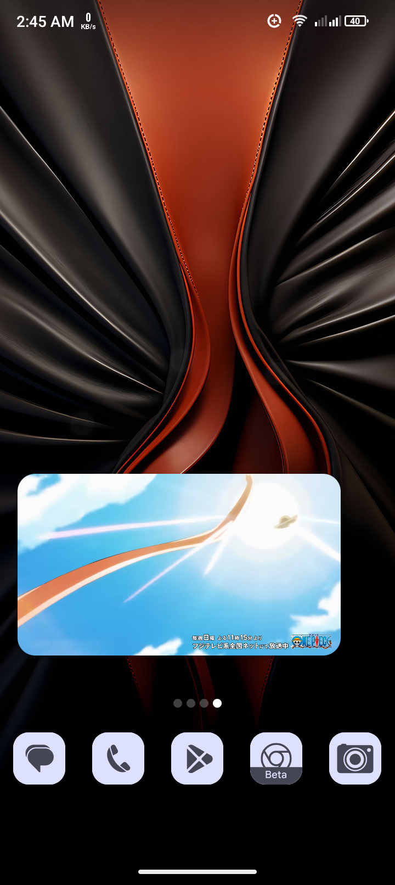
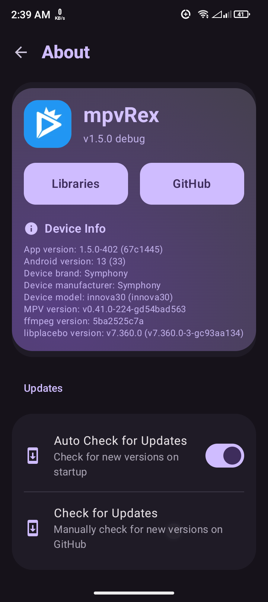
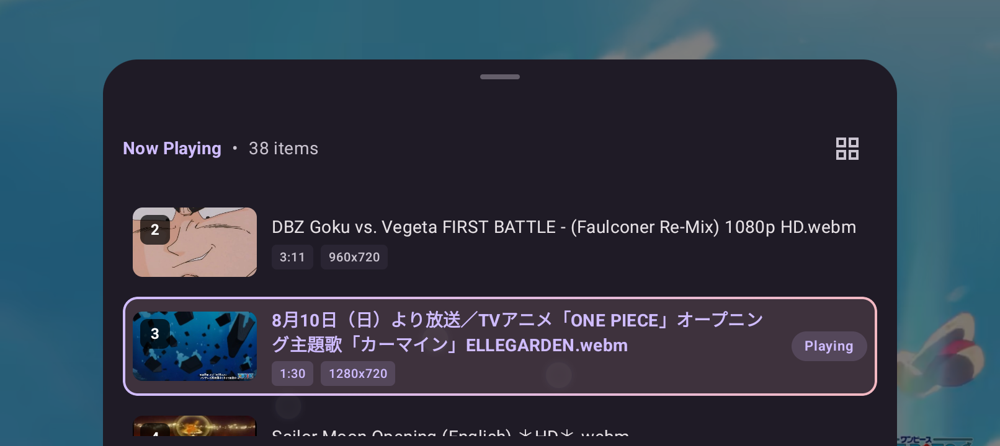
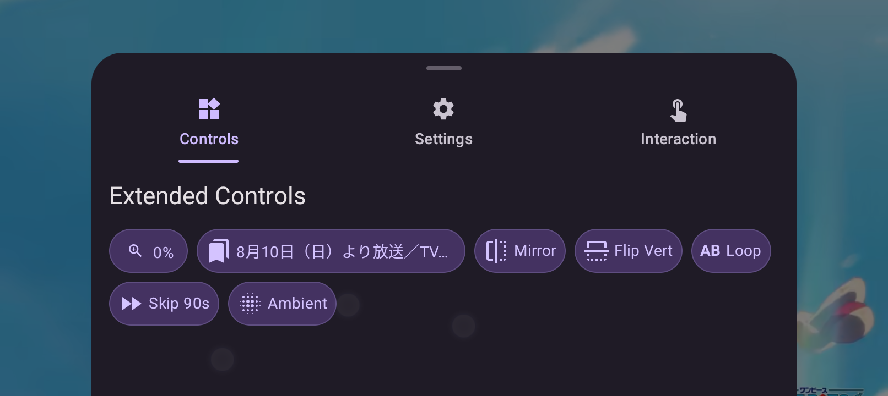

# Magen Player

  

  <b>Feature-rich Android video player based on libmpv.</b>

  
  
  
  
  

  

> [!NOTE]
> **Repository moved**: from `sfsakhawat999/MagenPlayer` to [MagenPlayer/Magen-Player](https://github.com/MagenPlayer/Magen-Player). Old links will redirect automatically.

> [!IMPORTANT]
> **This is the magen-gillan fork | هذه نسخة magen-gillan المخصصة** — based on REX Player / libmpv, with **Arabic subtitle support**, **MagenShorts**, and custom branding. Download builds **from this fork's releases**, not the upstream links below.
> **هذا المستودع نسخة مشتقة معدّة بواسطة magen-gillan مبنية على REX Player/libmpv مع دعم الترجمات العربية وMagenShorts وهوية مخصصة. حمّل الإصدارات من إصدارات هذا المستودع.**

---

## 📥 Download from this fork | التحميل من هذه النسخة

**Latest release | أحدث إصدار: [v5.5.3](https://github.com/magen-gillan/magen-player/releases/tag/v5.5.3)**

| Build | Link |
|---|---|
| arm64-v8a (most modern phones) | [magen-player-v5.5.3-arm64-v8a.apk](https://github.com/magen-gillan/magen-player/releases/download/v5.5.3/magen-player-v5.5.3-arm64-v8a.apk) |

Every release also ships a `.sha256` checksum file for verification.

---

Magen Player is an advanced, customizable video player for Android. It combines the versatility of libmpv with a modern Jetpack Compose interface and unique user-centric features.

---

## Showcase

  

  
  
  

  
  

---

## Features

- Advanced video playback powered by libmpv, with customizable gestures, frame navigation, zoom, and pan.
- Browse local files, organize playlists, track watched videos, and enjoy Shorts mode.
- Stream media from SMB, WebDAV, FTP, direct URLs, and supported web platforms using the optional Magen Ytdlp companion app.
- Customize the player with glass-themed controls, dynamic tabs, subtitle settings, and HDR-to-SDR tone mapping.
- Connect to Jellyfin and share files with nearby devices over your local network.

---

## Installation

  
  

<i>Preview builds may be unstable and are intended for testing only.</i>

---

## Translations

Translations can be managed using **[Droidlate](https://github.com/estiaksoyeb/Droidlate)** ([PyPI](https://pypi.org/project/droidlate/)) — a local, web-based UI designed for editing Android `strings.xml` translation files.

If you would like to contribute to translating Magen Player into your language, please refer to the [Translation Contribution Guide](CONTRIBUTING.md#translation-contributions) for step-by-step instructions on running Droidlate locally.

---

## المميزات | Features بالعربية

مشغل فيديو متقدم وأندرويد مبني على libmpv مع واجهة Jetpack Compose حديثة:

- تشغيل متقدم عبر **libmpv** مع إيماءات قابلة للتخصيص، تنقل بين الإطارات، تكبير وتحريك.
- استعراض الملفات المحلية وتنظيم قوائم التشغيل وتتبع ما تم مشاهدته، مع وضع **MagenShorts**.
- بث الوسائط من **SMB وWebDAV وFTP والروابط المباشرة** عبر تطبيق Magen Ytdlp المرافق.
- **دعم الترجمات العربية** وتخصيص المشغل بتحكم بتصميم زجاجي وتبويبات ديناميكية وضبط HDR إلى SDR.
- الاتصال بـ **Jellyfin** ومشاركة الملفات مع الأجهزة القريبة عبر الشبكة المحلية.

التحميل: جدول الإصدارات أعلاه (v5.5.1) من [إصدارات هذا المستودع](https://github.com/magen-gillan/magen-player/releases).

---

## Credits

Magen Player has its roots in **[MagenPlayer](https://github.com/marlboro-advance/MagenPlayer)**, which itself builds on **[mpv-android](https://github.com/mpv-android/mpv-android)**. We're grateful for the foundation they laid.

Additional inspiration and reference:
[mpvKt](https://github.com/abdallahmehiz/mpvKt) · [Next Player](https://github.com/anilbeesetti/nextplayer) · [Gramophone](https://github.com/FoedusProgramme/Gramophone)

---

## License

Distributed under the **Apache License 2.0**. See `LICENSE` for details.
